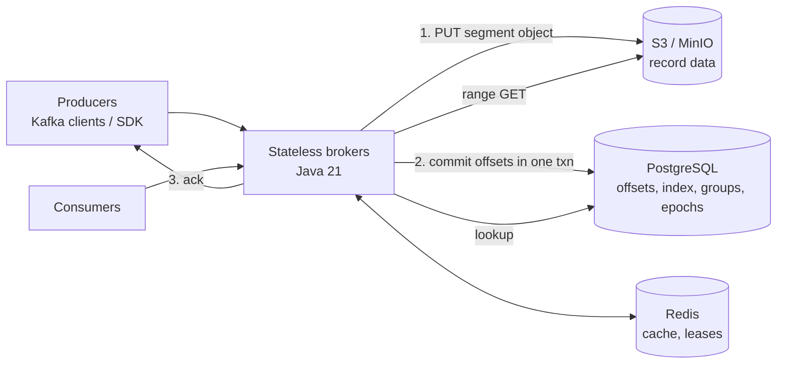

<div align="center">

# LakeWire

**Diskless, Kafka-compatible streaming on Postgres and S3.**

Stateless Java brokers. Your data lives in object storage, your offsets live in Postgres, and nothing lives on broker disks.

[](LICENSE)


</div>

> **Status: pre-alpha, under active development.** LakeWire is being built in public, with v0.1 targeted for mid-November 2026. APIs, the storage format and configuration will change. Every performance number in this README is a **target**, not a measured result, until the benchmark report is published.

---

## Why LakeWire?

Classic Kafka replicates every byte to three brokers across availability zones. In the cloud, that cross-zone traffic and those big attached disks are often the largest part of the bill.

LakeWire takes a different route:

- **No broker disks.** Brokers batch records and write them as immutable objects to S3 (or MinIO, R2 or any S3-compatible store). Kill any broker at any time and no data is lost.
- **Postgres is the coordinator.** Offsets, the segment index, consumer groups and broker epochs live in Postgres, the database your team already runs, backs up and understands. There's no ZooKeeper, no KRaft and no separate consensus cluster.
- **Speaks the Kafka wire protocol.** The goal is for stock Kafka clients, console tools and `kcat` to just work.
- **Correctness you can check.** Every release ships a fault-injection report that kills, pauses and partitions brokers while checking stated invariants.
- **A transparent cost model.** `lakewire cost` shows the $/GiB math against a 3-replica, cross-zone Kafka baseline, using public cloud prices you can verify.

**The trade-off:** latency is around a second, not milliseconds. LakeWire is built for analytics, logging, CDC and event pipelines where cost matters more than sub-10 ms latency.

## How it works



1. **Produce:** brokers buffer records across partitions for `linger.ms` (200 ms by default) or until a segment reaches 8 MiB, then upload one object.
2. **Commit:** a single Postgres transaction assigns dense, gap-free offsets for every partition in that object, and rejects the commit if the broker's epoch is stale.
3. **Ack:** the producer gets its offsets only after the commit succeeds, so an acknowledged write is never lost.
4. **Fetch:** consumers look up segments in Postgres, then read exactly the bytes they need from object storage, with a Redis or in-memory cache in front.

A broker that crashes after uploading but before committing leaves an orphan object, and garbage collection removes it. A paused "zombie" broker gets fenced by its stale epoch. Correctness depends only on Postgres, so losing Redis just costs cache hits.

## Quick start

> Coming with v0.1. The planned developer experience is:

```bash
git clone https://github.com/SunilMaurya-18/lakewire.git
cd lakewire
docker compose up -d          # Postgres, Redis, MinIO
./gradlew :lakewire-broker:bootRun
```

Then use any Kafka client:

```bash
kcat -b localhost:9092 -t events -P <<< "hello lakewire"
kcat -b localhost:9092 -t events -C -o beginning
```

## Features

| Feature | Status |
|---|---|
| Diskless produce path: buffer, upload to S3, commit, ack | 🚧 In progress |
| Fetch with byte-range reads and long-poll | 📋 Planned (v0.1) |
| Kafka wire protocol subset (ApiVersions, Metadata, Produce, Fetch, ListOffsets, InitProducerId, CreateTopics, DeleteTopics) | 📋 Planned (v0.1) |
| Idempotent producers (no duplicates on retry) | 📋 Planned (v0.1) |
| Multi-broker with Postgres epoch fencing | 📋 Planned (v0.1) |
| Orphan GC, retention, reference-counted object deletion | 📋 Planned (v0.1) |
| Fault-injection correctness suite in CI | 📋 Planned (v0.1) |
| Prometheus metrics and Grafana dashboard | 📋 Planned (v0.1) |
| `lakewire cost` calculator | 📋 Planned (v0.1) |
| Consumer groups | 📋 Planned (v0.2) |
| Segment compaction | 📋 Planned (v0.2) |
| Spring Boot starter | 📋 Planned |
| Helm chart | 📋 Planned |

**Non-goals for now:** exactly-once transactions, key-based log compaction, multi-region replication and sub-10 ms latency.

## Targets (not yet measured)

| Metric | Target |
|---|---|
| Produce latency (local MinIO, linger 200 ms) | P50 ≤ 300 ms, P99 ≤ 800 ms |
| End-to-end latency | P99 ≤ 1.5 s |
| Coordinator commit | P99 < 100 ms |
| Throughput (one laptop, 3 brokers) | ≥ 50 MiB/s sustained |
| Durability | Zero lost acknowledged writes under crash, pause, partition and Postgres failover |

Results, hardware details, configs and raw CSVs will be published in [`benchmarks/`](benchmarks/).

## Correctness guarantees

LakeWire is tested against these invariants under injected faults (broker kill, pause, network partition, slow or failing S3):

1. Every acknowledged record is readable.
2. Offsets in a partition are unique and have no gaps.
3. Order within a partition matches commit order.
4. Idempotent producers never create duplicate records on retry.
5. Committed consumer-group offsets never move backwards within a generation.

Delivery is **at-least-once** by default and duplicate-free with idempotent producers.

## Project layout

```
lakewire/
├── lakewire-broker/              # Spring Boot broker: produce, fetch, admin API
├── lakewire-storage/             # Segment format, S3 uploader, cache
├── lakewire-coordinator/         # Postgres commit logic, epochs, leases
├── lakewire-client/              # Lightweight Java SDK
├── lakewire-spring-boot-starter/ # Auto-configuration for Spring apps
├── lakewire-verify/              # Fault-injection harness and invariant checkers
├── benchmarks/                   # JMH and end-to-end benchmarks
├── deploy/                       # Docker Compose, Grafana dashboards, Helm
└── docs/                         # Design docs and ADRs
```

## Tech stack

Java 21 (virtual threads) · Spring Boot · gRPC and Netty · PostgreSQL · Flyway · Redis · AWS SDK v2 (S3, MinIO) · Micrometer and Prometheus · Testcontainers · JMH

## Roadmap

- **v0.1 (Nov 2026):** single and multi-broker diskless log, Kafka protocol subset, idempotent producers, correctness suite and the first benchmark report.
- **v0.2 (Dec 2026):** consumer groups, compaction, Spring Boot starter.
- **v0.3 (Feb 2027):** Helm chart, zone-aware reads, multi-tenancy with API keys.
- **v1.0 (Mar 2027):** stable storage format and public benchmarks on real S3.

## Contributing

LakeWire is early, which makes it a great time to get involved. Issues labelled [`good first issue`](https://github.com/SunilMaurya-18/lakewire/labels/good%20first%20issue) are a good place to start. Please open an issue before a large pull request so we can agree on the design first. See [`CONTRIBUTING.md`](CONTRIBUTING.md) for setup and style.

## Inspiration

LakeWire stands on the shoulders of [KIP-1150 (Diskless Topics)](https://cwiki.apache.org/confluence/display/KAFKA/KIP-1150%3A+Diskless+Topics), WarpStream, AutoMQ and Aiven's work on diskless Kafka, Jepsen's approach to testing distributed systems, and Martin Kleppmann's *Designing Data-Intensive Applications*.

## License

[Apache License 2.0](LICENSE)

## Author

Built by **Sunil Maurya** · [GitHub](https://github.com/SunilMaurya-18) · [LinkedIn](https://www.linkedin.com/in/sunil-maurya77) · [Portfolio](https://sunilmaurya-livid.vercel.app/)

If LakeWire is interesting to you, a ⭐ helps others find it.
