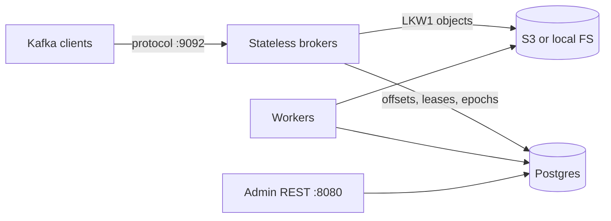

<div align="center">

# LakeWire

Kafka-compatible streaming with **no broker disks**.  
Postgres + object storage. Every invariant has a public checker.

[](https://github.com/SunilMaurya-18/lakewire/actions/workflows/ci.yml)
[](LICENSE)
[](https://adoptium.net/)
[](https://kafka.apache.org/)
[](docs/reports/correctness-v0.1.0.md)

[Quick start](#quick-start) · [What it is](#what-it-is) · [Guarantees](#correctness) · [Compatibility](#compatibility) · [Docs](docs/index.md)

</div>

> [!WARNING]
> **v0.1 is pre-alpha** (`0.1.0-SNAPSHOT`). Pinned Kafka protocol **subset**. **No consumer groups** (I6 is v0.2). Not for production.

## What it is

Brokers keep **no log on local disk**. RecordBatch v2 bytes go to S3 (or local FS) as LKW1 objects. Topics, offsets, leases and epochs live in **Postgres you run**. Any live broker can serve any partition; Metadata leadership is a routing hint.

It is not the cheapest or the most complete diskless Kafka. It is **small enough to verify**.



1. **Produce** — linger (200 ms) or 8 MiB, conditional PUT, then `sl_commit_object`. Ack only after **both**.
2. **Fetch** — only data below the Postgres high watermark. Visible = committed.
3. **Time** — leases and TTLs use Postgres `now()`, never the broker clock.
4. **Workers** — orphan GC, retention, I7/I8 audit.
5. **Zone** — `client.id=…,az=a` prefers a leader in that zone.

Deep dive: [architecture](docs/explanation/architecture.md) · [ADRs](docs/adr/README.md) · [upload-intent](docs/explanation/upload-intent.md)

## Cost (honest)

Transfer per GiB written, 3 zones, 8 MiB objects (`lakewire cost`, AWS us-east-1 list):

| | Classic Kafka RF=3 | LakeWire |
| --- | ---: | ---: |
| Producer → leader cross-AZ | ≈ $0.0133 | ≈ $0 |
| Replication | ≈ $0.0400 | $0 (S3) |
| S3 PUT + GET | — | ≈ $0.0008 |
| **Transfer + request** | **≈ $0.0533** | **≈ $0.0008** |

Storage is separate (EBS × 3 vs S3 ~$0.023/GB-month). **Produce/fetch latency is higher than disk Kafka** (linger + PUT). Postgres is a fixed cost at low volume.

[Cost model](docs/explanation/cost-model.md) · [laptop benchmarks](docs/reports/benchmark-v0.1.0.md)

## Quick start

**Needs:** Docker Desktop, or Java 21 for `lakewire dev`. Auto-create is **off**.

```powershell
git clone https://github.com/SunilMaurya-18/lakewire.git
cd lakewire
copy deploy\compose\.env.example deploy\compose\.env
docker compose -f deploy\compose\compose.yaml --env-file deploy\compose\.env up -d
```

Unix: `cp` and `/`. Then any Kafka client:

```text
bin/lakewire.cmd topics create orders -p 1 --retention 7d --bootstrap localhost:9092
echo hello | kcat -P -b localhost:9092 -t orders
kcat -C -b localhost:9092 -t orders -e
```

| | Port |
| --- | --- |
| Brokers (zones a / b / c) | `9092` / `9192` / `9292` |
| Admin | `8080` |
| Prometheus / Grafana | `9090` / `3000` |

### No Docker

```powershell
.\mvnw.cmd -pl lakewire-cli -am package -DskipTests
bin\lakewire.cmd dev
```

Prints `ready bootstrap=localhost:9092`. First start unpacks embedded Postgres (~10–15 s).

## Correctness

Source of truth: **[GUARANTEES.md](GUARANTEES.md)** · run notes: [correctness-v0.1.0.md](docs/reports/correctness-v0.1.0.md)

| ID | Promise | v0.1 |
| --- | --- | :---: |
| I1 | Acked record readable at that offset, same bytes | yes |
| I2 | Offsets contiguous from log start to HW | yes |
| I3 | Per-producer per-partition order | yes |
| I4 | No phantom / uncommitted data | yes |
| I5 | Idempotent retries do not duplicate | yes |
| I6 | Group offsets monotonic | **v0.2** |
| I7 | No dangling object refs | yes |
| I8 | No leaked objects older than orphan TTL + GC | yes |

```text
bin/lakewire.cmd verify --nemesis kill,pause,partition-pg --duration 3m --seed 42
```

PR CI: 3-minute smoke. Nightly: `.github/workflows/nemesis.yml`.

## Compatibility

`SupportedApi` pins ranges. Anything else → `UNSUPPORTED_VERSION`. Use `consumer.assign()` — **not** `subscribe()`.

| API | Versions | Java 4.4.0 | Kafka 4.4 console | kcat 1.7.1 |
| --- | --- | :---: | :---: | :---: |
| ApiVersions | 0–3 | yes | yes | yes |
| Metadata | 1–9 | yes | yes | yes |
| Produce | 3–12 | yes (idempotence) | yes | yes |
| Fetch | 4–12 | yes | yes | yes |
| ListOffsets | 1–6 | yes | yes | yes |
| InitProducerId | 0–4 | yes (no transactional id) | | |
| CreateTopics | 2–6 | yes | yes | |
| DeleteTopics | 1–5 | yes | yes | |

Not in v0.1: consumer groups, transactions, topic UUIDs. Full matrix: [compatibility.md](docs/reference/compatibility.md) · Spring: [spring-boot.md](docs/tutorials/spring-boot.md)

## Layout

```text
lakewire-protocol/     codec, SupportedApi, error mapping
lakewire-storage/      ObjectStore, LKW1
lakewire-coordinator/  Flyway + sl_* SQL
lakewire-workers/      GC, retention, audit
lakewire-broker/       Netty :9092
lakewire-cost/         §12.1 calculator
lakewire-admin/        Spring Boot REST :8080
lakewire-cli/          picocli
lakewire-testkit/      Testcontainers cluster
verify/                nemeses + checkers
deploy/compose/        3 brokers + Postgres + SeaweedFS + Grafana
docs/                  Diátaxis + reports
```

CLI: `bin/lakewire` / `bin/lakewire.cmd` · [config](docs/reference/config.md) · [admin REST](docs/reference/rest.md)

## Status

| Area | v0.1 | Later |
| --- | --- | --- |
| Produce / Fetch / Metadata / topics | done | topic UUIDs |
| Idempotent produce | done | transactions |
| S3 + local FS | done | GCS / Azure |
| Workers (GC, retention, audit) | done | key compaction (P2) |
| Admin, CLI, `dev`, compose | done | Helm |
| Consumer groups | — | v0.2 (I6) |
| Shared fetch cache (gRPC 9093) | — | v0.2 |
| Jepsen Kafka workload | — | v0.3 |

## Compared with

| | Kafka | AutoMQ / WarpStream-class | LakeWire |
| --- | --- | --- | --- |
| Broker disks | yes | no | no |
| Coordinator | KRaft | vendor control plane | **Postgres you run** |
| Protocol | full | broad | **subset, advertised** |
| Cost | EBS + cross-AZ RF=3 | object storage | published `lakewire cost` |
| Proof | battle-tested | production at scale | **public nemesis report** (small) |

## Contribute

**[CONTRIBUTING.md](CONTRIBUTING.md)** — DCO (`git commit -s`), Conventional Commits, Docker for `*IT.java`.

```text
.\mvnw.cmd -B verify
```

## Security and license

Vulnerabilities: **[SECURITY.md](SECURITY.md)** (private only).

[Apache License 2.0](LICENSE). Apache Kafka® is a trademark of the ASF; LakeWire is not affiliated ([NOTICE](NOTICE)).
