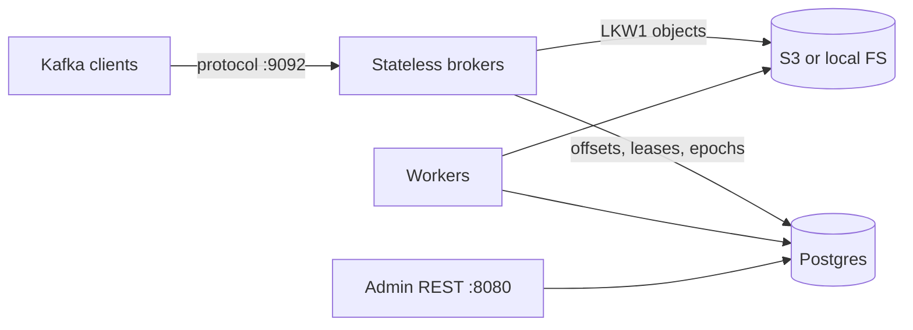

<div align="center">

# LakeWire

**Kafka-compatible streaming with no broker disks.  
Postgres + a bucket, and every guarantee tested in public.**

[](https://github.com/SunilMaurya-18/lakewire/actions/workflows/ci.yml)
[](LICENSE)
[](https://adoptium.net/)
[](https://kafka.apache.org/)
[](docs/reports/correctness-v0.1.0.md)

</div>

> [!WARNING]
> v0.1 is a **pre-alpha** snapshot (`0.1.0-SNAPSHOT`). It speaks a **pinned Kafka protocol subset**. There are **no consumer groups** (I6 is v0.2). Do not use it in production.

## Why

Brokers keep **no log on local disk**. Record batches go to object storage (S3 or local FS). Topics, offsets, leases and epochs live in Postgres. Any live broker can serve any partition; Metadata leadership is a routing hint.

Transfer cost per GiB written, 3 zones, 8 MiB objects (`lakewire cost`, AWS us-east-1 list prices):

| Per GiB written | Classic Kafka RF=3 | LakeWire |
| --- | ---: | ---: |
| Producer → leader cross-AZ | ≈ $0.0133 | ≈ $0 |
| Replication | ≈ $0.0400 | $0 (S3) |
| S3 PUT + GET | — | ≈ $0.0008 |
| **Transfer + request total** | **≈ $0.0533** | **≈ $0.0008** |

Storage is separate (EBS × 3 vs S3 $0.023/GB-month). **Honest trade-off: produce/fetch latency is higher than disk Kafka** (linger + PUT). Postgres is a fixed monthly cost at low volume. Formulas: [cost model](docs/explanation/cost-model.md). Laptop numbers: [benchmark report](docs/reports/benchmark-v0.1.0.md).

## Quick start

**Needs:** Docker Desktop (compose cluster) or Java 21 (`lakewire dev`). Auto-create is off.

```powershell
git clone https://github.com/SunilMaurya-18/lakewire.git
cd lakewire
copy deploy\compose\.env.example deploy\compose\.env
docker compose -f deploy\compose\compose.yaml --env-file deploy\compose\.env up -d
```

Unix: `cp` instead of `copy`, `/` instead of `\`.

Then create a topic and use any Kafka client (kcat shown):

```text
bin/lakewire.cmd topics create orders -p 1 --retention 7d --bootstrap localhost:9092
echo hello | kcat -P -b localhost:9092 -t orders
kcat -C -b localhost:9092 -t orders -e
```

Ports: brokers `9092` / `9192` / `9292` (zones a/b/c), admin `8080`, Prometheus `9090`, Grafana `3000`.

### One process, no Docker

```powershell
.\mvnw.cmd -pl lakewire-cli -am package -DskipTests
bin\lakewire.cmd dev
```

Prints `ready bootstrap=localhost:9092`. First start unpacks embedded Postgres (often 10–15 s); later starts are faster.

## How it works



1. **Produce** buffers until linger (default 200 ms) or 8 MiB, conditional-PUT to storage, then `sl_commit_object`. Ack only after **both**.
2. **Fetch** returns only data below the Postgres high watermark. Visible = committed.
3. **Leases and TTLs** use Postgres `now()`, not the broker clock.
4. **Workers** GC orphans, apply retention, audit I7/I8.
5. **Zone:** `client.id=…,az=a` prefers a leader in that zone.

More: [architecture](docs/explanation/architecture.md), [ADRs](docs/adr/README.md), [upload-intent race](docs/explanation/upload-intent.md).

## Correctness

Promises and checkers: **[GUARANTEES.md](GUARANTEES.md)**. Latest run notes: [correctness-v0.1.0.md](docs/reports/correctness-v0.1.0.md).

| ID | Promise | v0.1 |
| --- | --- | --- |
| I1 | Acked record is readable at that offset, same bytes | yes |
| I2 | Offsets contiguous from log start to HW | yes |
| I3 | Per-producer per-partition order | yes |
| I4 | No phantom / uncommitted data | yes |
| I5 | Idempotent retries do not duplicate | yes |
| I6 | Group offsets monotonic | **v0.2** |
| I7 | No dangling object refs | yes |
| I8 | No leaked objects older than orphan TTL + GC | yes |

Run the harness yourself:

```text
bin/lakewire.cmd verify --nemesis kill,pause,partition-pg --duration 3m --seed 42
```

PR CI runs a 3-minute smoke. Nightly: `.github/workflows/nemesis.yml`.

## Compatibility

`SupportedApi` / `SupportedApiTest` pin the ranges. Anything else → `UNSUPPORTED_VERSION`.

| API | Versions | Java 4.4.0 | Kafka 4.4 console | kcat 1.7.1 |
| --- | --- | --- | --- | --- |
| ApiVersions | 0–3 | yes | yes | yes |
| Metadata | 1–9 | yes | yes | yes |
| Produce | 3–12 | yes (idempotence on) | yes | yes |
| Fetch | 4–12 | yes | yes | yes |
| ListOffsets | 1–6 | yes | yes | yes |
| InitProducerId | 0–4 | yes (no transactional id) | | |
| CreateTopics | 2–6 | yes | yes | |
| DeleteTopics | 1–5 | yes | yes | |

Not in v0.1: consumer groups, transactions, topic UUIDs. Full table: [docs/reference/compatibility.md](docs/reference/compatibility.md).

Assign partitions (`consumer.assign`); do not `subscribe()`. Spring sketch: [docs/tutorials/spring-boot.md](docs/tutorials/spring-boot.md).

## Project layout

```text
lakewire-protocol/     Kafka codec, SupportedApi, error mapping
lakewire-storage/      ObjectStore, LKW1
lakewire-coordinator/  Flyway + sl_* SQL
lakewire-workers/      GC, retention, audit
lakewire-broker/       Netty :9092, produce/fetch
lakewire-cost/         §12.1 calculator
lakewire-admin/        Spring Boot REST :8080
lakewire-cli/          picocli (dev, broker, topics, cost, verify, inspect)
lakewire-testkit/      Testcontainers cluster
verify/                nemeses + checkers
bench/                 CSVs and scripts
deploy/compose/        3 brokers + Postgres + SeaweedFS + admin + Grafana
docs/                  tutorials, how-to, reference, explanation, reports
```

CLI: `bin/lakewire` / `bin/lakewire.cmd`. Env vars: [docs/reference/config.md](docs/reference/config.md). REST: [docs/reference/rest.md](docs/reference/rest.md).

## Status and roadmap

| Area | v0.1 | Later |
| --- | --- | --- |
| Produce / Fetch / Metadata / topics | done | topic UUIDs |
| Idempotent produce | done | transactions |
| S3 + local FS | done | GCS / Azure adapters |
| Workers (GC, retention, audit) | done | key compaction (P2) |
| Admin REST, CLI, `lakewire dev`, compose | done | Helm |
| Consumer groups | — | v0.2 (I6) |
| Shared fetch cache (gRPC 9093) | — | v0.2 |
| Jepsen Kafka workload | — | v0.3 |

## Compared with

| | Kafka | AutoMQ / WarpStream-class diskless | LakeWire |
| --- | --- | --- | --- |
| Broker disks | yes | no | no |
| Coordinator | KRaft | vendor control plane | **Postgres you run** |
| Kafka protocol | full | broad | **subset, advertised honestly** |
| Cost story | EBS + cross-AZ RF=3 | object storage | published `lakewire cost` |
| Proof | battle-tested | production at scale | **public nemesis report** (small) |

LakeWire is not trying to be the cheapest or the most complete diskless Kafka. It is trying to be **small enough to verify**.

## Contributing

Setup, module map, DCO, and how to add a checker: **[CONTRIBUTING.md](CONTRIBUTING.md)**.

```text
.\mvnw.cmd -B verify
```

Docker is required for `*IT.java`. Conventional Commits. `git commit -s`.

## Security

Private reports only: [SECURITY.md](SECURITY.md). Do not file public issues for vulnerabilities.

## License

[Apache License 2.0](LICENSE). Apache Kafka® is a trademark of the ASF; LakeWire is not affiliated ([NOTICE](NOTICE)).
