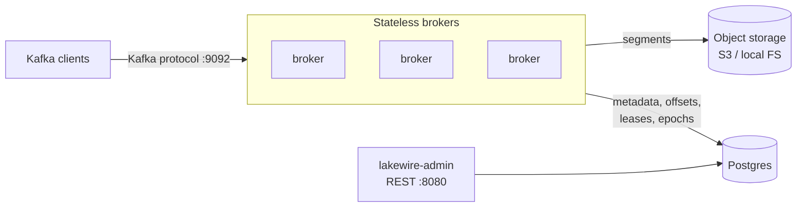
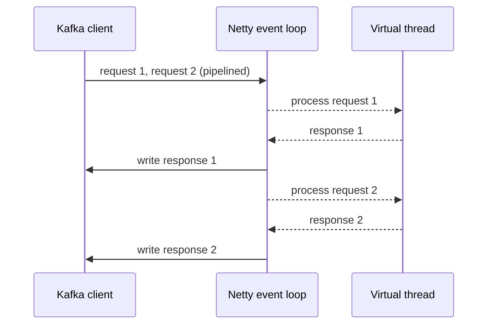

<div align="center">

# LakeWire

**A diskless, Kafka-compatible log built
on object storage.**


</div>

---

> [!WARNING]
> LakeWire is in early development. Only the
> `ApiVersions` API works today. Do not use
> it in production.

## Contents

- [What is LakeWire](#what-is-lakewire)
- [Design principles](#design-principles)
- [Architecture](#architecture)
- [How a request flows](#how-a-request-flows)
- [Kafka API support](#kafka-api-support)
- [Project layout](#project-layout)
- [Quick start](#quick-start)
- [Configuration](#configuration)
- [Testing](#testing)
- [Roadmap](#roadmap)
- [Contributing](#contributing)
- [Security](#security)
- [License](#license)

---

## What is LakeWire

LakeWire is a log service that speaks the
Kafka wire protocol, so existing Kafka
producers, consumers and tools can connect
without code changes.

Unlike Kafka, LakeWire brokers keep **no
data on local disk**:

- **Data** lives in object storage
  (S3, or the local filesystem in dev).
- **Coordination** lives in Postgres:
  topics, offsets, leases and epochs.
- **Brokers** are stateless. Add or remove
  them at any time; any broker can serve
  any request.

The result: no partition rebalancing, no
disk capacity planning, no replication
traffic between brokers.

---

## Design principles

1. **Compatibility first.** We reuse
   kafka-clients' generated message classes
   for every request and response, so the
   bytes on the wire match what real
   clients expect.
2. **Advertise only what works.**
   `ApiVersions` lists only implemented APIs,
   with version ranges pinned by tests.
   Everything else returns
   `UNSUPPORTED_VERSION`.
3. **Never block the event loop.** Netty
   threads only move bytes. Real work runs
   on Java 21 virtual threads.
4. **Ordering is a contract.** Requests on
   one connection are processed one at a
   time and answered in order, as Kafka
   clients and idempotent producers
   require.
5. **One source of truth.** Postgres is the
   only coordinator. No ZooKeeper, KRaft
   or Redis.
6. **Pinned, verified dependencies.** Every
   version is pinned and the build enforces
   Java 21+ and Maven 3.9+.

---

## Architecture



| Component   | Role                          | Status  |
| ----------- | ----------------------------- | ------- |
| Broker      | Kafka protocol server (9092)  | Partial |
| Protocol    | Kafka codec glue              | Partial |
| Storage     | ObjectStore SPI, FS and S3    | Planned |
| Coordinator | Postgres + Flyway migrations  | Planned |
| Workers     | Compaction, garbage collection| Planned |
| Admin       | REST API (8080)               | Planned |
| CLI         | Operator tooling              | Planned |

---

## How a request flows



1. Netty reads a length-prefixed frame.
2. The event loop copies the bytes and
   queues the work. It never waits.
3. A virtual thread decodes the request
   with kafka-clients, runs the handler and
   encodes the reply.
4. The event loop writes the reply.
5. The next request on that connection
   starts only after the previous reply
   is written. Other connections run in
   parallel.
6. After 16 unanswered requests on one
   connection, the broker pauses reading
   that socket (backpressure).

---

## Kafka API support

| API            | Key | Versions | Status  |
| -------------- | --- | -------- | ------- |
| ApiVersions    | 18  | 0–3      | Done    |
| Metadata       | 3   | –        | Planned |
| Produce        | 0   | –        | Planned |
| Fetch          | 1   | –        | Planned |
| ListOffsets    | 2   | –        | Planned |
| InitProducerId | 22  | –        | Planned |
| CreateTopics   | 19  | –        | Planned |
| DeleteTopics   | 20  | –        | Planned |

Clients newer than the broker are handled
with KIP-511 version fallback: the broker
replies with its supported range and the
client retries at a version both support.

---

## Project layout

```text
lakewire/
├── lakewire-protocol/   Kafka codec glue
├── lakewire-broker/     Netty server,
│                        request handling
├── deploy/
│   └── compose/         Local Postgres
├── docs/                Design documents
└── web/                 Project website
```

---

## Quick start

**Requirements:** Java 21+, Docker. Maven
is optional; the `mvnw` wrapper is included.

```powershell
# 1. Build and run all tests
.\mvnw.cmd clean verify

# 2. Start local Postgres
cd deploy\compose
copy .env.example .env   # set a password
docker compose up -d
cd ..\..

# 3. Run the broker
.\mvnw.cmd install -DskipTests
.\mvnw.cmd -pl lakewire-broker exec:java
```

On macOS/Linux use `./mvnw` and `cp`.

The broker listens on `0.0.0.0:9092`.
Stop it with Ctrl+C; in-flight requests
finish before it exits.

---

## Configuration

| Variable                   | Default   | Meaning                 |
| -------------------------- | --------- | ----------------------- |
| `LAKEWIRE_HOST`            | `0.0.0.0` | Address to bind         |
| `LAKEWIRE_PORT`            | `9092`    | Kafka protocol port     |
| `LAKEWIRE_MAX_FRAME_BYTES` | see code  | Largest request allowed |

Secrets live in `.env` files, which are
gitignored. Commit only `.env.example`.

---

## Testing

```powershell
.\mvnw.cmd clean verify
```

The suite starts a real broker on a random
port and talks to it over real sockets:

- **Protocol tests:** the registry and the
  encoding and decoding of requests and
  responses.
- **ApiVersions tests:** v0–v3, unsupported
  and future versions, invalid client
  names, unknown API keys.
- **Ordering tests:** one-at-a-time
  processing per connection, parallel
  connections, failure handling, and 200
  pipelined requests.

---

## Roadmap

- [x] Maven multi-module build, pinned deps
- [x] Netty server with framing
- [x] ApiVersions on kafka-clients classes
- [x] Virtual threads, ordered replies,
      backpressure
- [ ] Metadata (`kcat -L`, admin tools)
- [ ] ObjectStore SPI: local FS, then S3
- [ ] Postgres coordinator with Flyway
- [ ] CreateTopics / DeleteTopics
- [ ] Produce and Fetch
- [ ] Idempotent producers, leases, epochs
- [ ] Compaction and garbage collection
- [ ] Admin REST API and CLI
- [ ] Helm chart and benchmarks

---

## Contributing

1. Create a branch:
   `git checkout -b feature/short-name`
2. Keep every change covered by tests.
3. Run `.\mvnw.cmd clean verify` before
   pushing. It must be green.
4. Open a pull request with a clear
   description.

Never commit `.env` files, keys or
credentials.

---

## Security

Please do not open public issues for
security problems. Report them privately
to the maintainer.

---

## License

TBD. Until a license is added, all rights
are reserved.
